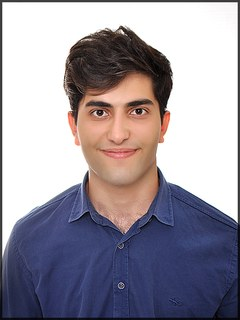
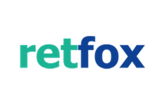
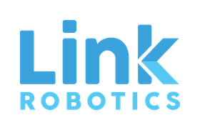
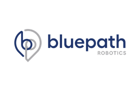
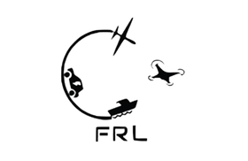
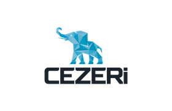

---
hide:
  - navigation
  - toc
---

$ whoami

# Burak Rüstemoğulları

Robotik &amp; otonom sistemler

Otonom sistemler üzerine çalışıyorum: algılama, kontrol ve bilgisayarlı görü.
Bu sitede projelerimi ve teknik notlarımı bir arada topluyorum.

`ROS 2` `C++` `Python` `Kontrol Teorisi` `Bilgisayarlı Görü`

[GitHub](https://github.com/BurakRustemogullari){ .md-button }
[LinkedIn](https://www.linkedin.com/in/burakrustemogullari){ .md-button }

{ .hero-portrait width="240" height="320" }

-   [:material-radar:{ .xl } **Wi-Fi Sensing**](wifi-sensing/index.md)

## Deneyim {: .home-heading .reveal }

<ol class="timeline reveal">
<li class="timeline__item timeline__item--current">

Mar 2026 — devam ediyor

Yazılım Sistem Test Mühendisi

<a href="http://www.retfox.com/" target="_blank" rel="noopener">retfox</a>

</li>
<li class="timeline__item">

Eki 2024 — Eki 2025 · 1 yıl 1 ay

Robotics Software Engineer

<a href="https://linkrobotik.com/" target="_blank" rel="noopener">Link Robotics</a>

</li>
<li class="timeline__item">

Tem 2024 — Ağu 2024 · 2 ay

Robotics Software Developer Stajyer

<a href="https://bluepathrobotics.com/" target="_blank" rel="noopener">Bluepath Robotics</a> · İstanbul

</li>
<li class="timeline__item">

Eyl 2022 — Ağu 2024 · 2 yıl

Software Developer &amp; Researcher

<a href="https://fieldroboticslab.github.io/" target="_blank" rel="noopener">Team IMU</a>

</li>
<li class="timeline__item">

Tem 2023 — Ağu 2023 · 2 ay

Robotics Software Developer Stajyer

<a href="https://www.cezerirobot.com/tr/" target="_blank" rel="noopener">Cezeri Yapay Zeka Robotik Teknolojileri</a> · İstanbul

</li>
</ol>

## İletişim {: .home-heading }

- **GitHub** — [github.com/BurakRustemogullari](https://github.com/BurakRustemogullari)
- **LinkedIn** — [linkedin.com/in/burakrustemogullari](https://www.linkedin.com/in/burakrustemogullari)
- **E-posta** — [rustemogullarib@gmail.com](mailto:rustemogullarib@gmail.com)

