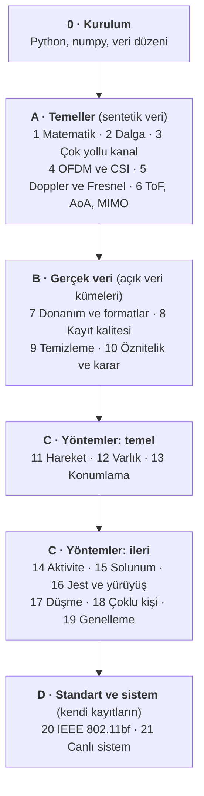

# Wi-Fi Sensing

Wi-Fi sinyallerinden ortamdaki insanları, hareketi ve nefesi anlamayı **sıfırdan**
öğrenmek için hazırlanmış bir ders akışı. Hedef, sonunda bir CSI kaydını açıp
temizleyen, öznitelik çıkaran, model kuran ve sonucu dürüstçe değerlendiren
kodları **kendi başına** yazabilmek.

!!! info "Durum: iskelet"
    Bütün modüllerin hedefleri, konu başlıkları, kaynakları ve alıştırmaları
    belirlendi. Anlatımlar modül modül yazılacak.

## Yol haritası

## Bölümler

| Bölüm | Ne öğrenilir | Kod neyle yazılır |
|---|---|---|
| [A · Temeller](temeller/index.md) | Fazör, FFT, çok yollu kanal, OFDM, CSI'nin nereden çıktığı, Doppler, Fresnel | Sentetik veri (numpy) |
| [B · Gerçek veri](veri/index.md) | CSI donanımları, kayıt formatları, kalite kontrolü, temizleme, öznitelik ve değerlendirme | Açık veri kümeleri |
| [C · Yöntemler](yontemler/index.md) | Hareket, varlık, konum, aktivite, solunum, jest, düşme, çoklu kişi, genelleme | Makaleleri yeniden üretmek |
| [D · Standart ve sistem](sistem/index.md) | IEEE 802.11bf, uçtan uca canlı sistem | Kendi Zyxel/ESP32 kayıtları |

## Nasıl çalışılır

1. **Sırayla ilerle.** Her modül bir öncekinin kavramlarını bilinen kabul eder.
   Modül başındaki *Ön koşul* satırı neyin gerektiğini söyler.
2. **Okuduğunu koda dök.** Her modülde alıştırmalar var. Önce kendin yaz;
   takılırsan anlatıma dön, en son hazır bir koda bak.
3. **Kendini kontrol et.** Modül sonundaki soruları yanıtlayamıyorsan bir sonrakine geçme.
4. **Makaleyi yeniden üret.** C bölümünde her yöntem bir makaleye dayanır. Amaç
   makaledeki sayıyı birebir tutturmak değil, aynı fikri kendi verinde çalıştırmaktır.

## İlerleme

- [ ] [0 · Kurulum](baslangic/kurulum.md)
- [ ] A · Temeller (modül 1–6)
- [ ] B · Gerçek veri (modül 7–10)
- [ ] C · Yöntemler (modül 11–19)
- [ ] D · Standart ve sistem (modül 20–21)

Ekler: [Makaleler](ekler/makaleler.md) · [Veri kümeleri](ekler/veri-kumeleri.md) · [Sözlük](ekler/sozluk.md)
